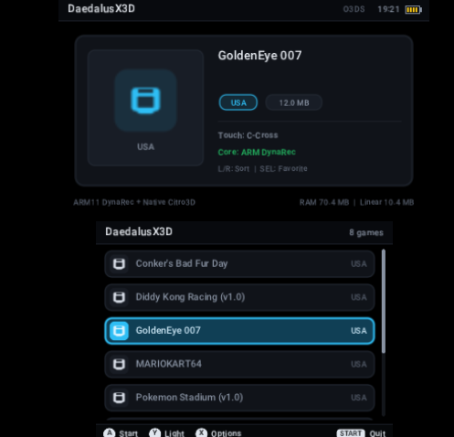
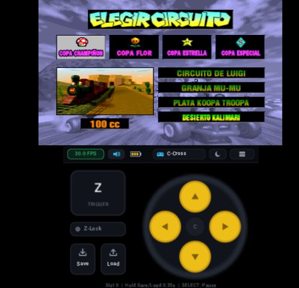
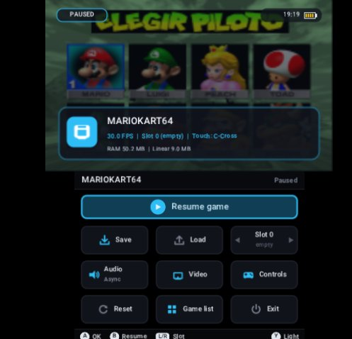

# DaedalusX3D (Old 3DS Edition)

🌐 **Languages:** **English** | [Português (Brasil)](README.pt-BR.md)

A fork of **DaedalusX64** focused and tuned specifically for **Nintendo 3DS Old / 2DS** (`ARMv6K` ARM11 MPCore @ 268 MHz, VFPv2, 16 KB L1 I/D-cache, 6 MiB VRAM, PICA200), featuring a native **`citro3d` / PICA200** graphics backend, a modern 3DS-native dual-screen frontend, automatic box-art scraping, and interactive bottom-screen extension controls during gameplay.

---

## Screenshots

| ROM Browser (Dual-Screen) | In-Game Touch Extension (`C-Cross` + `Z`) | Pause Menu (Frozen Game Backdrop) |
| :---: | :---: | :---: |
|  |  |  |

---

## Current Status & Performance (Old 3DS)

- **High Compatibility & Speed**: *Super Mario 64*, *Mario Kart 64*, *Diddy Kong Racing*, *Super Smash Bros.*, *GoldenEye 007*, *The Legend of Zelda: Ocarina of Time*, and *Pokemon Stadium* run at full or near-full native N64 speed with clean async audio.
- **3DS-Native Dual-Screen Frontend (`citro3d`)**:
  - **Proportional Roboto typography & single-atlas SDF UI**: crisp rounded cards, smooth 2D spring focus animations, system clock & battery status, and 1-tap **Light / Dark** theme toggle via `Y` (plus *Midnight* and *Stealth* themes).
  - **Automatic Box-Art Scraper**: automatically downloads missing N64 covers over 3DS Wi-Fi (`httpc` + `libretro-thumbnails`) in a low-priority background thread and saves compact `128×128` PNGs to `sdmc:/3ds/DaedalusX64/Resources/Preview/`.
  - **Interactive In-Game Bottom Screen**: acts as a physical control extension for missing Old 3DS inputs (**4-way yellow N64 C-Buttons Cross** by default, **Virtual C-Stick Camera**, **Dual-Analog Shooter** stick-swap, **N64 D-Pad**, dedicated **Z Trigger** + **Z-Lock**, hold-guarded **Quick Save / Quick Load**, live FPS/mute/battery bar, and **Sleep** battery-saver mode) with *dirty-driven* rendering (zero GPU/DMA overhead on idle frames).
  - **Frosted Pause Overlay**: captures the live N64 top screen behind an animated translucent banner alongside a CTR64-inspired 3×3 pause grid (`Resume`, `Save`, `Load`, `Slot 0–4`, `Audio`, `Video`, `Controls`, `Reset`, `Game list`, `Exit`).
- **Implemented Optimizations** (see full details in [CHANGELOG.md](CHANGELOG.md)):
  - **Native `citro3d` / PICA200 Backend**: unified GX command queue, 6-stage hardware TEV combiner (`PicaTEVCombiner`), `GPU_TRIANGLES` draw batching, fast-state cache, hardware `GX_MemoryFill` clears, and `FastInvSqrtCTR` vertex lighting.
  - **ARMv6K DynaRec**: selective per-range fragment invalidation (eliminating full cache flushes on small dynamic overlays), 4096-entry direct-mapped indirect jump table (`gIndirectJumpTable`), inlined delay slots for branch-likely exits, lazy 64-bit sign extension, 7 cached ARM GPRs, native `BGEZAL`/`BLTZAL`/`DIV`/`DIVU`, direct VFP `VLDR`/`VSTR` (`LWC1`/`SWC1`/`LDC1`/`SDC1`), and constant folding.
  - **3D Pipeline (VFPv2)**: hardware vector **VFPv2 `LEN=4`** assembly for vertex transformation and 4×4 matrix multiplication, UV scaling fused into `PrepareTrisUnclipped()`, and direct `CI4`/`CI8` → `RGBA5551` texture decoding.
  - **Async HLE Audio (Core 1 / Core 2)**: offloads `Audio_Ucode` onto Core 1 (Old 3DS syscore) / Core 2 (New 3DS) with exact ABI1/ABI2/ABI3 double-buffer range tracking, 1-cycle ARMv6 `SSAT` saturation, and smooth ring-buffer playback.

### Roadmap
- [x] **Graphics backend migration (`picaGL` → `citro3d` / native PICA200)** — shipped in `v0.1.0-Stable`.
- [x] **Core 1/2 async HLE audio offload & selective DynaRec invalidation** — shipped in `v0.1.0-Stable`.
- [ ] Further per-game compatibility and Old 3DS bandwidth tuning.

---

## Releases

Pre-built binaries are published on the GitHub **[Releases](../../releases)** page:
- **`DaedalusX64.3dsx`** — for **Homebrew Launcher**
- **`DaedalusX64.cia`** — for direct Home Menu installation via **FBI**

*(Locally after building, release artifacts are also staged in [`releases/`](releases/README.md).)*

---

## Installation on Nintendo 3DS

### 1. Audio Prerequisite (`dspfirm.cdc`)
The emulator requires the 3DS DSP firmware dump for audio output:
- Ensure `sdmc:/3ds/dspfirm.cdc` exists on your SD card.
- If missing, run **DSP1** (or use Rosalina's DSP firmware dump option) once.

### 2. SD Card Folder Layout
Create the following directory structure on your SD card:

```text
sdmc:/
└── 3ds/
    ├── dspfirm.cdc                  # DSP firmware (required for audio)
    └── DaedalusX64/
        ├── DaedalusX64.3dsx         # Executable (if using Homebrew Launcher)
        ├── Roms/                    # <-- PLACE YOUR ROMs HERE (.z64, .n64, .v64)
        │   ├── Mario Kart 64.z64
        │   └── Super Smash Bros.z64
        ├── SaveGames/               # Native saves (EEPROM / SRAM / Flash / MemPak)
        ├── SaveStates/              # Save states
        └── Resources/               # Optional box art / resources
```

> If you install **`DaedalusX64.cia`** via **FBI**, the ROMs directory remains the same: `sdmc:/3ds/DaedalusX64/Roms/`.

### 3. Controls
- **`SELECT` or Bottom-Screen `☰` Button**: opens the in-game pause menu (Save/Load States, Audio, Video/ROM Options, Touch Controls, Reset, Game List, Exit).
- **Bottom Screen (In-Game)**:
  - **Yellow C-Cross (default)** / **C-Stick Camera** / **Dual-Analog Shooter** / **N64 D-Pad** / **Sleep**: tap the mode pill on the top HUD strip to switch live, or customize handedness, deadzone, sensitivity, and `Z-Lock` in **Pause → Controls**.
  - **Dedicated `Z` Trigger & `Z-Lock`**: ergonomic access to N64 `Z` on Old 3DS.
  - **Quick Save / Quick Load**: hold for `0.35s` to prevent accidental taps.
- **`Y` (in menus)**: instantly toggles between **Dark** and **Light** 3DS themes.
- **`L` / `R` (in ROM Browser)**: cycles sorting (`A-Z`, `Favorites`, `Size`) | **`SELECT`**: toggles Favorite.
- **Circle Pad**: N64 analog stick (or C-Buttons strafe when `Dual-Analog Shooter` mode is active).

---

## Building from Source (Old 3DS)

### Prerequisites
Install **devkitPro / devkitARM** with `libctru`, `picaGL`, and `cmake`:
- `DEVKITPRO` and `DEVKITARM` environment variables configured.
- ARM `libpng` and `zlib` installed under `build-3ds-local/vendor/` (or pointed to via `DAEDALUS_CTR_DEPS_DIR`).

### Build `.3dsx` and `.cia`
```sh
cmake -S Source -B build-3ds-local \
  -DCMAKE_TOOLCHAIN_FILE="$PWD/Tools/3dstoolchain.cmake" \
  -DCTR_RELEASE=ON

cmake --build build-3ds-local --target N3DS -j"$(nproc)"
```

Generated binaries will be placed in:
- `build-3ds-local/DaedalusX64.3dsx`
- `build-3ds-local/DaedalusX64.cia`
- `build-3ds-local/DaedalusX64.elf`

### Running Host Unit Tests
```sh
sh tests/ctr_host/run.sh
```

---

## Project Structure

- [`Source/Core/`](Source/Core/) — R4300i CPU, memory, DMA, interrupts, RSP HLE, save states.
- [`Source/DynaRec/`](Source/DynaRec/) — Dynamic recompiler infrastructure and fragment cache.
- [`Source/HLEAudio/`](Source/HLEAudio/) — HLE audio mixing (ABIs 1/2/3, ADPCM, resample, ring buffer).
- [`Source/HLEGraphics/`](Source/HLEGraphics/) — Display List parser, T&L, texture cache and conversion.
- [`Source/SysCTR/`](Source/SysCTR/) — Nintendo 3DS platform layer (`DynaRec/arm`, `HLEGraphics`, `HLEAudio`, `UI/FrontendCTR`, `Input`, `Utility`).
- [`Data/`](Data/) — Compatibility database (`roms.ini`), cheats (`Daedalus.cht`), controller configs, and languages.
- [`Tools/`](Tools/) — `devkitARM` CMake toolchain (`3dstoolchain.cmake`).
- [`tests/`](tests/) — Host unit test suite (`ctr_host`).
- [`releases/`](releases/) — Staging directory for release binaries (`.3dsx` / `.cia`).

## License
Based on **DaedalusX64** under the GNU GPL v2 license ([`copying.txt`](copying.txt)).
