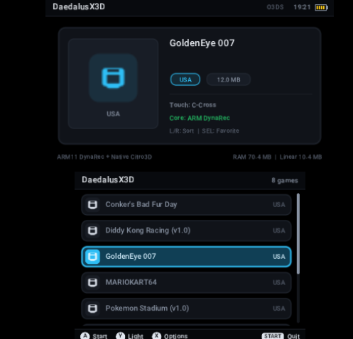
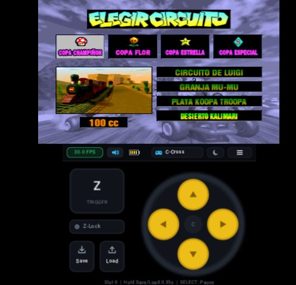
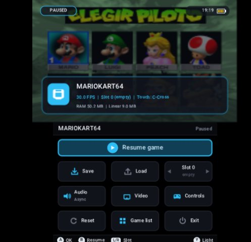

# DaedalusX3D (Old 3DS Edition)

🌐 **Idiomas:** [English](README.md) | **Português (Brasil)**

Fork do **DaedalusX64** focado e otimizado especificamente para **Nintendo 3DS Old / 2DS** (`ARMv6K` ARM11 MPCore @ 268 MHz, VFPv2, 16 KB L1 I/D-cache, 6 MiB VRAM, PICA200), com backend gráfico nativo em **`citro3d` / PICA200**, frontend moderno estilo nativo do 3DS, download automático de capas por Wi-Fi e tela inferior interativa com extensão de controles durante o gameplay.

---

## Capturas de Tela

| Biblioteca de ROMs (Dual-Screen) | Controles Táteis In-Game (`C-Cross` + `Z`) | Menu de Pausa (Jogo Congelado ao Fundo) |
| :---: | :---: | :---: |
|  |  |  |

---

## Status Atual & Desempenho (Old 3DS)

- **Alta Compatibilidade & Velocidade**: *Super Mario 64*, *Mario Kart 64*, *Diddy Kong Racing*, *Super Smash Bros.*, *GoldenEye 007*, *The Legend of Zelda: Ocarina of Time* e *Pokemon Stadium* rodando em velocidade nativa (ou muito próxima) com áudio assíncrono limpo.
- **Frontend Nativo 3DS em duas telas (`citro3d`)**:
  - **Tipografia proporcional Roboto & Atlas SDF único**: cards arredondados nítidos, animações suaves com mola 2D, relógio e bateria do sistema, e alternância rápida **Dark / Light** com `Y` (além dos temas *Midnight* e *Stealth*).
  - **Scraping Automático de Capas**: baixa automaticamente capas faltantes do N64 pelo Wi-Fi do 3DS (`httpc` + `libretro-thumbnails`) em segundo plano, redimensionando para PNGs leves de até `128×128` em `sdmc:/3ds/DaedalusX64/Resources/Preview/`.
  - **Tela Inferior Interativa In-Game**: funciona como extensão dos controles físicos ausentes no Old 3DS (**Botões C amarelos em cruz** como padrão, **C-Stick Virtual** para câmera, **Dual-Analog Shooter**, **D-Pad N64**, gatilho **`Z`** dedicado + **`Z-Lock`**, **Quick Save / Quick Load** com proteção de hold de 0,35s, barra de FPS/mute/bateria e modo **Sleep**) com renderização *dirty-driven* (custo zero de GPU/DMA nos frames ociosos).
  - **Pausa com Fundo Congelado**: captura o frame atual do jogo na tela superior com vinheta fosca animada enquanto exibe o grid 3×3 de pausa estilo CTR64 na tela inferior (`Resume`, `Save`, `Load`, `Slot 0–4`, `Audio`, `Video`, `Controls`, `Reset`, `Game list`, `Exit`).
- **Otimizações implementadas** (detalhes completos em [CHANGELOG.md](CHANGELOG.md)):
  - **Backend Nativo `citro3d` / PICA200**: fila GX unificada, combiner TEV em hardware de 6 estágios (`PicaTEVCombiner`), batching de `GPU_TRIANGLES`, cache de estado rápido, clears em hardware via `GX_MemoryFill` e iluminação de vértices com `FastInvSqrtCTR`.
  - **DynaRec ARMv6K**: invalidação seletiva por faixa no cache de fragmentos (eliminando resets totais em micro-overlays dinâmicos), tabela direta global de 4096 entradas para saltos indiretos (`gIndirectJumpTable`), inlining de delay slot em saídas *branch-likely*, extensão de sinal 64-bit lazy, 7 registradores ARM em cache, `BGEZAL`/`BLTZAL`/`DIV`/`DIVU` nativos, `VLDR`/`VSTR` direto em `LWC1`/`SWC1`/`LDC1`/`SDC1` e constant folding.
  - **Pipeline 3D (VFPv2)**: transformação de vértices e multiplicação de matrizes 4×4 em assembly **VFPv2 `LEN=4`**, fusão de escala UV em `PrepareTrisUnclipped()` e decodificação direta `CI4`/`CI8` → `RGBA5551`.
  - **Áudio HLE Assíncrono (Core 1 / Core 2)**: execução de `Audio_Ucode` em thread dedicada no Core 1 (syscore do Old 3DS) / Core 2 (New 3DS) com rastreamento exato de faixas de saída ABI1/ABI2/ABI3, saturação em 1 ciclo via `SSAT` e reprodução suave sem travar o Core 0.

### Roadmap
- [x] **Migração de backend gráfico (`picaGL` → `citro3d` / PICA200 nativo)** — entregue na `v0.1.0-Stable`.
- [x] **Offload de áudio HLE no Core 1/2 e invalidação seletiva no DynaRec** — entregue na `v0.1.0-Stable`.
- [ ] Mais otimizações de banda no Old 3DS e melhorias de compatibilidade por jogo.

---

## Releases

Os binários prontos para uso ficam disponíveis na aba **[Releases](../../releases)** do GitHub:
- **`DaedalusX64.3dsx`** — para executar pelo **Homebrew Launcher**
- **`DaedalusX64.cia`** — para instalar direto na tela inicial via **FBI**

*(Localmente após compilar, os arquivos também são copiados para [`releases/`](releases/README.md).)*

---

## Instalação no Nintendo 3DS

### 1. Pré-requisito de áudio (`dspfirm.cdc`)
O emulador precisa do dump do firmware DSP do 3DS para reproduzir áudio:
- Verifique se o arquivo `sdmc:/3ds/dspfirm.cdc` existe no cartão SD.
- Se não existir, use o homebrew **DSP1** (ou a opção de dump de DSP do Rosalina) uma única vez.

### 2. Estrutura de pastas no cartão SD
Crie a estrutura abaixo no cartão SD:

```text
sdmc:/
└── 3ds/
    ├── dspfirm.cdc                  # Firmware DSP (obrigatório)
    └── DaedalusX64/
        ├── DaedalusX64.3dsx         # Executável (se usar Homebrew Launcher)
        ├── Roms/                    # <-- COLOQUE SUAS ROMs AQUI (.z64, .n64, .v64)
        │   ├── Mario Kart 64.z64
        │   └── Super Smash Bros.z64
        ├── SaveGames/               # Saves nativos (EEPROM / SRAM / Flash / MemPak)
        ├── SaveStates/              # Save states
        └── Resources/               # Capas/recursos opcionais
```

> Se você instalar o **`DaedalusX64.cia`** via **FBI**, a pasta de ROMs continua sendo a mesma: `sdmc:/3ds/DaedalusX64/Roms/`.

### 3. Controles no Emulador
- **`SELECT` ou botão `☰` na tela inferior**: abre o menu de pausa (Save/Load States, Áudio, Opções de Vídeo/ROM, Controles Táteis, Reset, Biblioteca, Sair).
- **Tela Inferior (In-Game)**:
  - **Botões C em Cruz (padrão)** / **C-Stick Câmera** / **Dual-Analog Shooter** / **D-Pad N64** / **Sleep**: toque no botão de modo na barra superior para alternar ao vivo, ou personalize mão destra/canhota, zona morta, sensibilidade e `Z-Lock` em **Pausa → Controls**.
  - **Gatilho `Z` dedicado & `Z-Lock`**: acesso ergonômico ao `Z` do N64 no Old 3DS.
  - **Quick Save / Quick Load**: segure por `0,35s` para evitar toques acidentais.
- **`Y` (nos menus)**: alterna instantaneamente entre os temas **Dark** e **Light**.
- **`L` / `R` (na biblioteca)**: altera a ordenação (`A-Z`, `Favorites`, `Size`) | **`SELECT`**: marca/desmarca Favorito.
- **Circle Pad**: analógico do N64 (ou C-Buttons para andar/strafe no modo `Dual-Analog Shooter`).

---

## Como Compilar (Build Old 3DS)

### Pré-requisitos
Instale o **devkitPro / devkitARM** com `libctru`, `picaGL` e `cmake`:
- `DEVKITPRO` e `DEVKITARM` configurados no ambiente.
- Dependências ARM (`libpng` e `zlib`) instaladas em `build-3ds-local/vendor/` (ou via `DAEDALUS_CTR_DEPS_DIR`).

### Compilando o `.3dsx` e `.cia`
```sh
cmake -S Source -B build-3ds-local \
  -DCMAKE_TOOLCHAIN_FILE="$PWD/Tools/3dstoolchain.cmake" \
  -DCTR_RELEASE=ON

cmake --build build-3ds-local --target N3DS -j"$(nproc)"
```

Os binários gerados estarão em:
- `build-3ds-local/DaedalusX64.3dsx`
- `build-3ds-local/DaedalusX64.cia`
- `build-3ds-local/DaedalusX64.elf`

### Executando os testes de host
```sh
sh tests/ctr_host/run.sh
```

---

## Estrutura do Projeto

- [`Source/Core/`](Source/Core/) — CPU R4300i, memória, DMA, interrupções, RSP HLE, save states.
- [`Source/DynaRec/`](Source/DynaRec/) — Infraestrutura do recompilador dinâmico e cache de fragmentos.
- [`Source/HLEAudio/`](Source/HLEAudio/) — Mixagem HLE de áudio (ABIs 1/2/3, ADPCM, resample, ring buffer).
- [`Source/HLEGraphics/`](Source/HLEGraphics/) — Parser de Display List, T&L, cache e conversão de texturas.
- [`Source/SysCTR/`](Source/SysCTR/) — Código específico de Nintendo 3DS (`DynaRec/arm`, `HLEGraphics`, `HLEAudio`, `UI/FrontendCTR`, `Input`, `Utility`).
- [`Data/`](Data/) — Banco de compatibilidade (`roms.ini`), cheats (`Daedalus.cht`), configurações de controle e traduções.
- [`Tools/`](Tools/) — Toolchain CMake para `devkitARM` (`3dstoolchain.cmake`).
- [`tests/`](tests/) — Suíte de testes unitários de host (`ctr_host`).
- [`releases/`](releases/) — Pasta preparada para empacotamento de releases (`.3dsx` / `.cia`).

## Licença
Baseado no **DaedalusX64** sob licença GNU GPL v2 ([`copying.txt`](copying.txt)).
